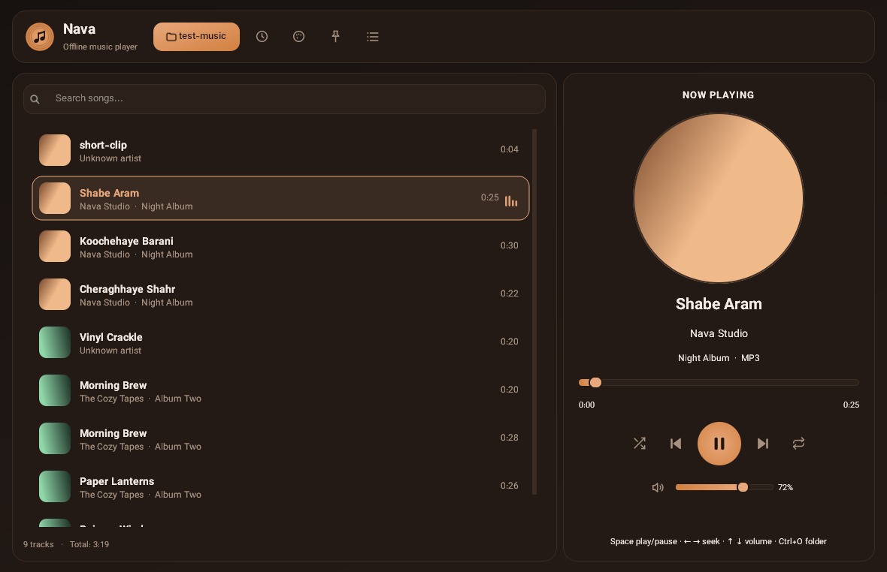
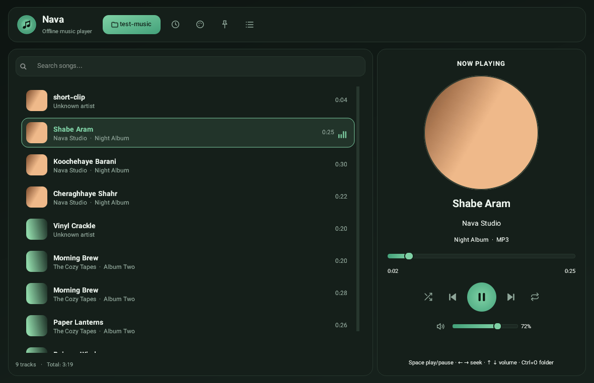
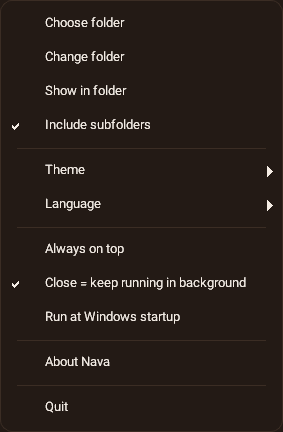
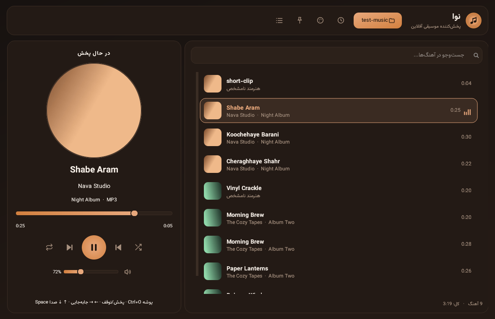
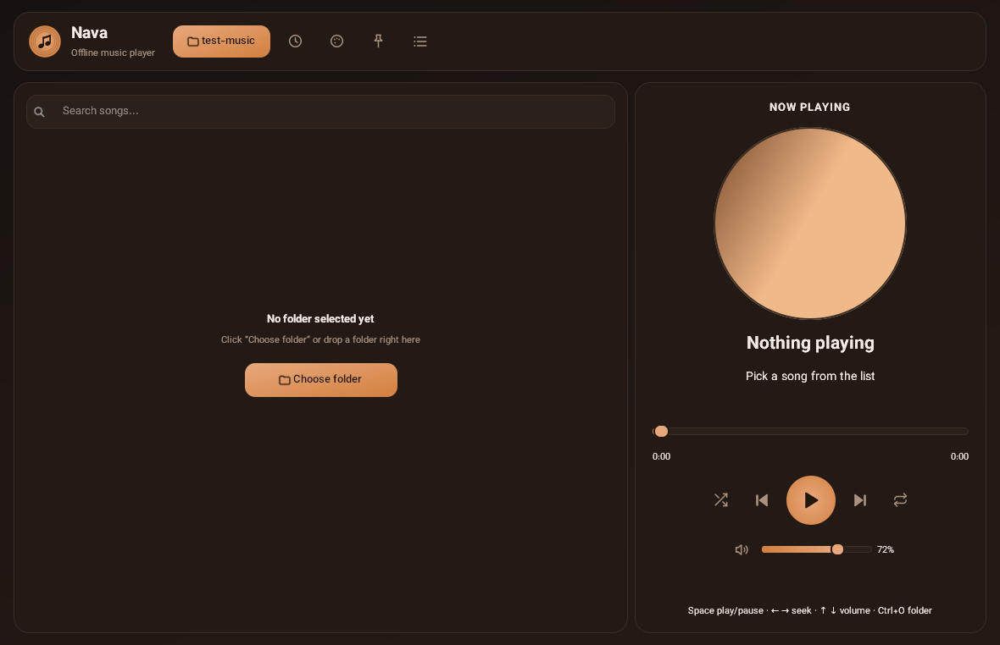
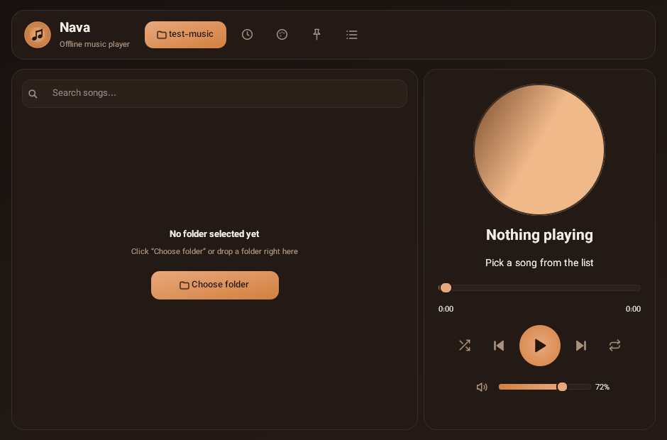

# 🎧 نوا — پخش‌کننده موسیقی آفلاین

**نوا** یک موزیک‌پلیر **آفلاین، سبک و cozy** برای ویندوز است که بعد از بستن پنجره هم **در پس‌زمینه به پخش ادامه می‌دهد**.
کافی است آدرس یک پوشه را بدهی؛ خودش آهنگ‌ها، تگ‌ها و کاور آلبوم‌ها را می‌خواند — بدون حساب کاربری، بدون اینترنت.

[English README](README.md) · [راهنمای ساخت exe](HOWTO-build-exe.fa.md) · [Build guide (EN)](HOWTO-build-exe.md)




---

## ✨ امکانات

| | |
|---|---|
| 📁 **کتابخانه از روی پوشه** | آدرس یک پوشه را می‌دهی (یا داخل پنجره رها می‌کنی) و همه‌ی فایل‌های صوتی خوانده می‌شوند؛ زیرپوشه‌ها اختیاری |
| 🎵 **پشتیبانی از فرمت‌ها** | mp3، m4a/aac، flac، wav، ogg/opus، wma، aiff، ape، wv |
| 🖼 **کاور آلبوم** | کاور داخل فایل‌ها (ID3 / FLAC / MP4 / WMA) یا فایل `cover.jpg` کنار آهنگ‌ها |
| 🏷 **خواندن متادیتا** | عنوان، هنرمند، آلبوم، شماره ترک و مدت‌زمان با کتابخانه‌ی [mutagen](https://mutagen.readthedocs.io/) |
| 🌙 **در پس‌زمینه می‌ماند** | بستن پنجره = رفتن به سینی سیستم؛ موسیقی قطع نمی‌شود |
| 🖱 **منوی سینی** | پخش/توقف، بعدی، قبلی، نمایش/پنهان‌کردن پنجره، خروج کامل |
| 🎨 **۴ پوسته cozy** | قهوه و کارامل، جنگل نیمه‌شب، شب نیلی، غروب گرم |
| 🌐 **انگلیسی و فارسی** | زبان پیش‌فرض **انگلیسی** است؛ از منوی برنامه → Language → فارسی (چیدمان کامل راست‌به‌چپ) |
| 🔎 **جست‌وجو** | فیلتر لحظه‌ای روی عنوان / هنرمند / آلبوم |
| 🔀 **تصادفی و تکرار** | تکرار یکی · تکرار همه · پخش تصادفی |
| ⌨️ **کلیدهای میان‌بر و رسانه‌ای** | Space، ← →، ↑ ↓ و کلیدهای Media کیبورد/هدست |
| 🚀 **اجرای خودکار با ویندوز** | یک گزینه در منو (بی‌صدا در سینی بالا می‌آید) |
| 📌 **همیشه روی بقیه پنجره‌ها** | پین‌کردن پنجره |
| 🖥 **پشتیبانی HiDPI** | تصویر شارپ روی مانیتورهای اسکیل‌شده و چندمانیتوره |

---

## 📸 نمایی از برنامه

| در حال پخش (قهوه و کارامل) | پوسته جنگل نیمه‌شب |
|---|---|
|  |  |

| منوی برنامه | رابط فارسی (راست‌به‌چپ) |
|---|---|
|  |  |

| حالت خالی | پنجره‌ی کوچک |
|---|---|
|  |  |

---

## ⬇️ گرفتن نسخه‌ی ویندوزی

**راه اول — خودت exe را بساز (دو کلیک، حدود ۵ دقیقه)**

1. مخزن را دانلود کن (**Code → Download ZIP**) و در مسیر ساده‌ای مثل `C:\nava-player` اکسترکت کن.
2. [Python 3.11 (64-bit)](https://www.python.org/downloads/) را نصب کن — تیک **«Add python.exe to PATH»** را یادت نرود.
3. روی **`build.bat`** دوبار کلیک کن → فایل نهایی ساخته می‌شود: **`dist\Nava.exe`**

راهنمای گام‌به‌گام با رفع خطاها: **[HOWTO-build-exe.fa.md](HOWTO-build-exe.fa.md)**

**راه دوم — گیت‌هاب برایت بسازد**

مخزن را روی گیت‌هاب push کن و ورک‌فلوی **Build Windows EXE** را اجرا کن
(*Actions → Build Windows EXE → Run workflow*). فایل `Nava.exe` را از بخش **Artifacts** همان اجرا دانلود کن — حتی بدون ویندوز!

> 🔐 **درباره‌ی SmartScreen:** فایل `Nava.exe` امضای دیجیتال ندارد، پس بار اول ممکن است پیام
> *«Windows protected your PC»* ببینی → **More info → Run anyway**.
> یا در PowerShell دستور `Unblock-File .\Nava.exe` را اجرا کن.

### اولین اجرا

1. روی **«Choose folder / انتخاب پوشه»** بزن و پوشه‌ی موسیقی‌ات را انتخاب کن.
2. هر آهنگی را پخش کن؛ کاور، تگ‌ها و مدت‌زمان خودکار نمایش داده می‌شوند.
3. هر وقت خواستی پنجره را ببند — نوا در سینی سیستم می‌ماند و پخش ادامه دارد.
   برای خروج کامل، روی آیکون سینی راست‌کلیک کن → **Quit** (یا `Ctrl+Q`).

---

## 🛠 اجرا از روی سورس

نیاز: **Python 3.10+** (تست‌شده روی 3.11) — روی ویندوز، لینوکس و مک کار می‌کند.

```bash
git clone https://github.com/<your-username>/nava-player.git
cd nava-player
pip install -r requirements.txt
python main.py
```

اجرای مستقیم روی یک پوشه:

```bash
python main.py "D:/Music"
```

سوئیچ‌های مفید:

```bash
python main.py --diagnose              # گزارش دستگاه‌های صوتی + تست رمزگشایی
python main.py --smoketest "D:/Music"  # اسکن، ۳ ثانیه پخش، بررسی حالت پس‌زمینه، خروج
python main.py --autostart             # همان دستوری که ویندوز هنگام بوت اجرا می‌کند
```

---

## 📦 ساخت فایل exe

خلاصه‌ی سریع (داخل پوشه‌ی پروژه در ویندوز):

```bat
python -m pip install -r requirements.txt pyinstaller
python tools\make_ico.py
python -m PyInstaller --noconfirm --clean Nava.spec
```

→ خروجی: `dist\Nava.exe` (تک‌فایل، پنجره‌ای، حدود ۵۰ مگابایت — Qt و کدک‌های صوتی داخلش هستند).

حوصله‌ی تایپ نداری؟ فقط روی **`build.bat`** دوبار کلیک کن.
جزئیات کامل، حالت onedir، تغییر آیکون/اسم و همه‌ی خطاهای رایج: **[HOWTO-build-exe.fa.md](HOWTO-build-exe.fa.md)**

---

## ⌨️ کلیدهای میان‌بر

| کلید | کار |
|---|---|
| `Space` | پخش / توقف |
| `←` / `→` | ۵ ثانیه عقب / جلو |
| `↑` / `↓` | کم و زیاد کردن صدا |
| `Ctrl+O` | انتخاب پوشه |
| `Ctrl+F` | جست‌وجو |
| `Ctrl+S` | پخش تصادفی |
| `Ctrl+R` | تغییر حالت تکرار |
| `Ctrl+Q` | خروج کامل |
| `Esc` | پنهان‌کردن پنجره (پخش ادامه دارد) |
| کلیدهای Media | پخش/توقف، بعدی، قبلی |

---

## ☰ منوی برنامه (آیکون فهرست در هدر)

- انتخاب پوشه · تغییر پوشه · نمایش در پوشه · خواندن زیرپوشه‌ها
- پوسته (۴ تم)
- زبان (English / فارسی)
- همیشه روی بقیه پنجره‌ها
- **بستن = ماندن در پس‌زمینه** (اگر خاموشش کنی، دکمه‌ی X برنامه را کامل می‌بندد)
- اجرای خودکار با ویندوز
- درباره نوا · خروج

---

## 📂 ساختار پروژه

```
nava-player/
├── main.py                 # نقطه‌ی شروع (+ --diagnose / --smoketest / --autostart)
├── Nava.spec               # دستور ساخت با PyInstaller
├── build.bat               # ساخت exe در ویندوز با یک کلیک
├── requirements.txt
├── nava.ico                # آیکون چند‌اندازه
├── assets/                 # صدای تست برای --diagnose
├── screenshots/
├── nava/
│   ├── window.py           # پنجره‌ی اصلی، لیست، سینی، منوها
│   ├── player.py           # موتور پخش (QMediaPlayer): صف، تصادفی، تکرار
│   ├── library.py          # اسکن پوشه، تگ و کاور با mutagen
│   ├── widgets.py          # دکمه‌های آیکونی، کاور گرد، نوار پخش
│   ├── theme.py            # پالت‌ها + استایل‌شیت سراسری
│   ├── icons.py            # آیکون‌های SVG داخلی + آیکون برنامه
│   ├── i18n.py             # متن‌های انگلیسی/فارسی
│   ├── config.py           # تنظیمات در %APPDATA%\NavaPlayer\config.json
│   └── winutils.py         # اجرای خودکار، تیتربار تیره، دکمه‌های Taskbar
└── tools/                  # make_ico.py، shots.py، engine_test.py
```

**تنظیمات** در `%APPDATA%\NavaPlayer\config.json` ذخیره می‌شود (آخرین پوشه، صدا، تم، زبان، موقعیت پنجره…).

---

## 🔧 عیب‌یابی

**صدا پخش نمی‌شود؟** این را روی همان سیستم اجرا کن:

```bat
Nava.exe --diagnose
```

تعداد دستگاه‌های خروجی صدا و نتیجه‌ی تست رمزگشایی را نشان می‌دهد.
همچنین مطمئن شو [Microsoft Visual C++ Redistributable (x64)](https://aka.ms/vs/17/release/vc_redist.x64.exe) نصب است (تقریباً روی همه‌ی ویندوزها هست).

**exe باز نمی‌شود / خطای DLL؟** همان بسته‌ی VC++ بالا را نصب کن و با `build.bat` دوباره بساز.

**فایل flac/wma پخش نمی‌شود؟** پخش با موتور FFmpeg داخلی Qt انجام می‌شود؛ mp3/m4a/wav همیشه کار می‌کنند.

**پوشه‌ی بزرگ کند است؟** اسکن در نخ جدا انجام می‌شود و نتایج دسته‌دسته نمایش داده می‌شوند؛ برنامه فریز نمی‌شود.
برای کتابخانه‌های خیلی بزرگ گزینه‌ی «Include subfolders» را خاموش کن.

**آنتی‌ویروس به exe گیر می‌دهد؟** exe‌های امضانشده‌ی PyInstaller گاهی هشدار کاذب می‌گیرند —
پوشه را در Exception آنتی‌ویروس بگذار، یا نسخه‌ی سبک‌تر *onedir* را بساز (در راهنما توضیح داده شده).

---

## 🤝 مشارکت

Issue و Pull Request خوش‌آمد است. چند نکته:

- متن‌های رابط را در `nava/i18n.py` نگه دار (هر دو زبان) و رنگ‌ها را در `nava/theme.py`.
- با `python tools/shots.py` اسکرین‌شات‌های همین README دوباره ساخته می‌شوند.
- با `python tools/engine_test.py` می‌توانی پخش/بعدی/قبلی/سیک/تصادفی/تکرار را بدون رابط گرافیکی تست کنی.

## 📜 مجوز

MIT — فایل [LICENSE](LICENSE). استفاده، تغییر و انتشار آزاد است.

ساخته‌شده با [Qt for Python (PySide6)](https://doc.qt.io/qtforpython/) و [mutagen](https://mutagen.readthedocs.io/).
همه‌ی آیکون‌ها SVG داخلی هستند؛ برنامه هیچ فایل تصویری بیرونی ندارد.
